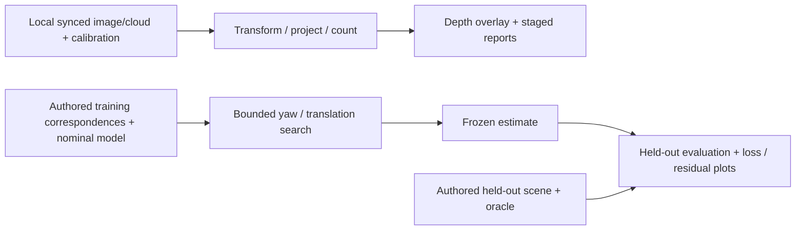
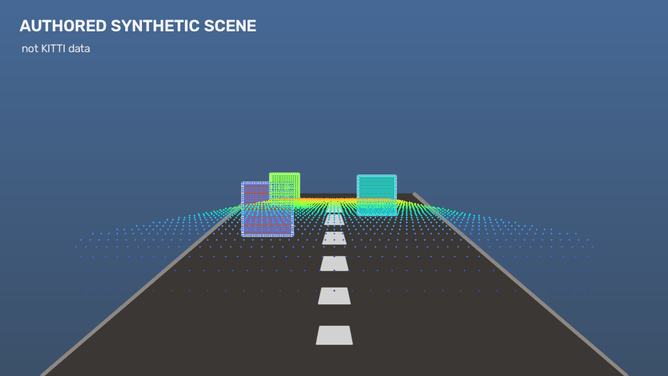

# sensor-fusion-replay-cpp

[](https://github.com/WeiHanTu/sensor-fusion-replay-cpp/actions/workflows/ci.yml)

C++20 offline camera–LiDAR geometry and controlled synthetic extrinsic recovery.
Explicit frames, strict input validation, reproducible artifacts and auditable
tests—not a production, real-time or safety system.

## What works today

| Path | Implemented behavior | Evidence boundary |
| --- | --- | --- |
| One-frame projection | KITTI Raw synced/rectified loading, full 3x4 projection, depth overlay, rejection accounting and staged JSON/PNG output | Synthetic numeric/integration tests; one historical private KITTI smoke run |
| Calibration sensitivity | Left-applied camera-y yaw and camera-x translation comparisons | Change relative to supplied calibration, not calibration accuracy |
| Synthetic extrinsic recovery | Bounded two-parameter search, L2/Huber loss, training-only selection, held-out evaluation and identifiability diagnostics | Project-authored, explicitly keyed 3D-to-2D correspondences only |

`v0.1.0` is the immutable geometry baseline. Recovery is an additive experiment.
Perception (`v0.2`) and queues/synchronization/backpressure (`v0.3`) are **not
implemented**. The repository name does not imply state-estimation sensor fusion.

## Architecture



Geometry is Eigen-only. I/O and rendering use OpenCV; JSON stays outside geometry.
No oracle or held-out input enters parameter selection. See
[architecture and source/test maps](docs/architecture.md) and
[frame conventions](docs/frame_conventions.md).

## Quick start — no KITTI account or data

On Ubuntu 24.04, install the system dependencies:

```bash
sudo apt-get update
sudo apt-get install --yes cmake g++ libeigen3-dev libopencv-dev \
  nlohmann-json3-dev libgtest-dev
```

From the repository root:

```bash
cmake --preset release
cmake --build --preset release --parallel
ctest --preset release --output-on-failure
./build/release/generate_synthetic_kitti --output-dir artifacts/quickstart_kitti
./build/release/project_kitti \
  --dataset-root artifacts/quickstart_kitti --drive synthetic_drive_sync \
  --frame 0 --output-dir artifacts/quickstart_projection
./build/release/generate_extrinsic_fixture \
  --output-dir artifacts/quickstart_extrinsic --hidden-yaw-deg 0.7 --hidden-tx-m -0.04
./build/release/estimate_extrinsics \
  --dataset-root artifacts/quickstart_extrinsic --train-frames 0,1 --validation-frames 2 \
  --parameters yaw_camera_y,translation_camera_x --loss huber \
  --output-dir artifacts/quickstart_recovery --run-id joint
```

The CLIs print their output directories. Projection produces `run_summary.json`,
`frames.jsonl` and a depth overlay. Recovery produces `report.json`, candidate
and keyed residual JSON, overlays and loss/residual plots. Check
`acceptance.passed` as well as the exit code: a completed search can miss the
scientific gate. Existing fixtures/runs are refused; use new paths for a rerun.

All generated data above are project-authored and ignored by Git. First
configuration may fetch pinned test dependencies. Required CMake is **3.28+**;
see [setup, macOS, troubleshooting and private KITTI usage](docs/getting_started.md).



Color encodes rectified-camera depth. This is a reproducible pipeline demonstration,
not KITTI imagery or calibration ground truth. The sensitivity comparison and its
[provenance/reproduction commands](docs/images/README.md) are available separately.

## Recovery results and limits

A project-authored synthetic experiment recovers bounded camera-yaw and
camera-x-translation corrections from known 3D-to-2D correspondences and
evaluates them on held-out authored frames.

Two distinct training scenes contain 372 observations; the held-out scene has 160.
All 21 frozen A–E cases, including failures, are retained in the
[machine-readable evidence](docs/evidence/extrinsic_recovery_v1.json).

| Experiment | Measured result |
| --- | --- |
| Seven clean on-grid cases | All half-fine-step parameter and held-out gates pass |
| 37 bad training correspondences | Clean held-out RMSE: L2 4.095 px, Huber 0.194 px; both miss strict clean parameter accuracy |
| Narrow geometry | Scaled condition approximately 380386; not accepted as identifiable |
| Restricted bounds / off-grid truth | Bound-limited / refinement-limited results, not successful recovery |

The [exact-commit verification](docs/extrinsic_recovery_verification.md) records
clean source `e876725`, 135/135 C++ checks on macOS dev/Release and each Ubuntu
GCC, Clang and ASan/UBSan job. These counts are historical evidence, not a promise
about a later checkout; the CI badge links to current runs.

Antithetic-noise results are not general i.i.d. noise robustness. This does not
verify physical/KITTI calibration, calibration from arbitrary images, HIL,
sim-to-real or online calibration. Native macOS sanitizer initialization fails
on the recorded host; Ubuntu is the verified sanitizer platform.

## Development and documentation

Use [CONTRIBUTING.md](CONTRIBUTING.md) for dev/sanitizer/format/tidy and offline
repository checks. Design and evidence are separate:

- [Documentation index](docs/README.md): usage, architecture and verification.
- [Recovery experiment](docs/extrinsic_recovery.md): model, search, A–E campaign and failure semantics.
- [Projection benchmark](docs/benchmark_walkthrough.md): optimized commands, measured scope and historical report—not end-to-end latency.
- [Dependencies and reproducibility](docs/dependencies.md): minimums, fallback commits and build limitations.
- [Change log](CHANGELOG.md) and [security reporting](SECURITY.md).
- Product intent: [intend.md](intend.md); behavior/gates: [spec.md](spec.md); roadmap: [plan.md](plan.md).

## License and data

Project-authored code and documentation use [Apache-2.0](LICENSE). Dependencies
retain their own licenses. KITTI data is not included, redistributed or relicensed.
Obtain authorized data separately from [KITTI Raw Data](https://www.cvlibs.net/datasets/kitti/raw_data.php).
Do not upload KITTI files, derived screenshots, credentials or private dataset paths
to issues, pull requests or public artifacts.
