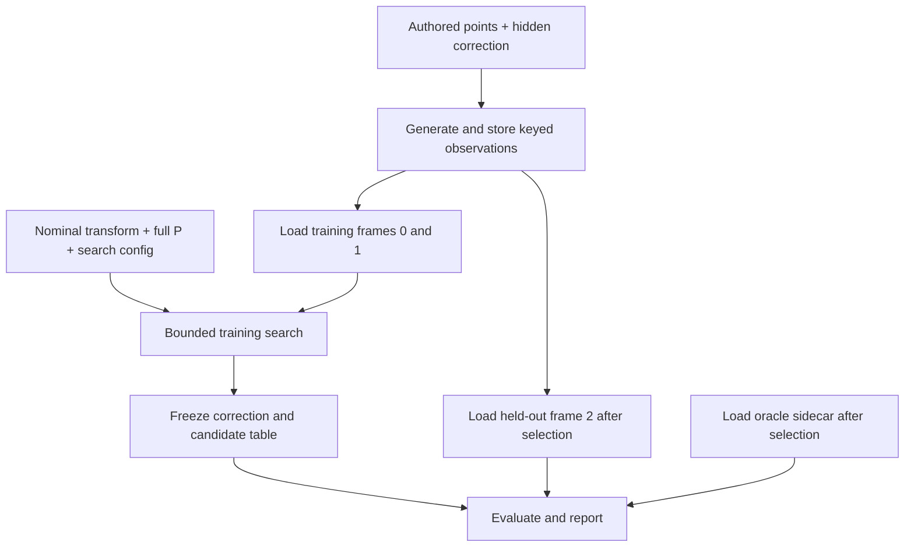
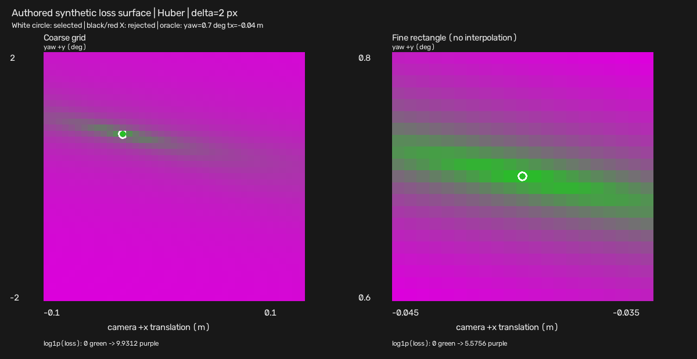
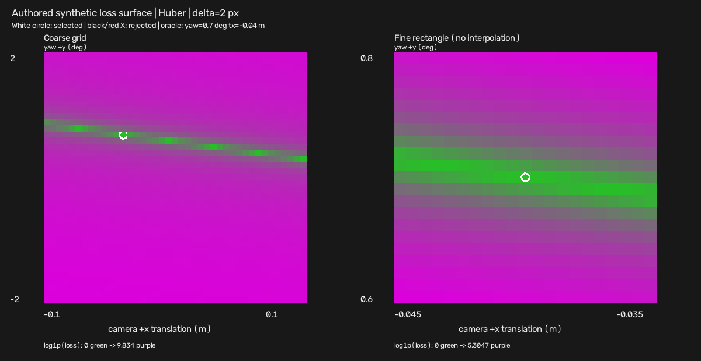

# Controlled Synthetic Extrinsic Parameter Recovery

Design approved 2026-10-12; implemented and verified on the declared authored
fixtures at `e876725`. See [the exact-commit record](extrinsic_recovery_verification.md).
Draft dirty runs are not the published acceptance record.
This document explains the implemented model and its limitations. Requirements
are in [spec §17](../spec.md#17-controlled-synthetic-extrinsic-recovery-v1);
ordered work is in [plan §4b](../plan.md#4b-synthetic-extrinsic-recovery-v1-design-review-2026-10-12).

## Implemented entry points

`generate_extrinsic_fixture` authors three scenes and keyed point/pixel JSON,
`estimate_extrinsics` fits training frames before opening oracle/held-out data,
and `run_extrinsic_campaign` executes the frozen A-E matrix. See
[architecture/source/test navigation](architecture.md#synthetic-recovery-fit-versus-evaluation-boundary).
The estimator remains Eigen-only; JSON/codecs are outside geometry.

```bash
cmake --preset release
cmake --build --preset release --parallel
./build/release/generate_extrinsic_fixture \
  --output-dir artifacts/synthetic_extrinsic_fixture \
  --hidden-yaw-deg 0.7 --hidden-tx-m -0.04
./build/release/estimate_extrinsics \
  --dataset-root artifacts/synthetic_extrinsic_fixture \
  --train-frames 0,1 --validation-frames 2 \
  --parameters yaw_camera_y,translation_camera_x --loss huber \
  --output-dir artifacts/extrinsic_recovery --run-id joint
./build/release/run_extrinsic_campaign \
  --output-dir artifacts/extrinsic_recovery --run-id campaign
```

Existing exact fixtures/runs are refused; only deliberate replacement uses
`--overwrite`. Stages owned elsewhere are always preserved. CLI exit categories
are 0 valid completed grid (check acceptance separately), 2 configuration,
3 input, 4 search/identifiability limitation after a report, and 5 output.
Campaign exit 4 retains required-gate failures rather than manufacturing success.

## Observable and access boundary

An observation binds a named authored 3D point in LiDAR coordinates to a stored
synthetic target `(u,v)`. The key is `(frame_id, source_index)`; the loader
explicitly joins point and target records and validates duplicates/missing keys.
Targets are generated with a hidden transform and optional declared corruption,
then stored before fitting. They are never recomputed from the nominal transform
as if those projected pixels were independent observations.

The UV-only target type deliberately excludes `ImageProjection.depth_camera_m`.
Finite non-negative weight defaults to 1.0; a zero weight is an explicit counted
mask. Images serve as authored visualization backgrounds and target displays;
there is no feature detector, association model, or real-data objective.



The estimator's C++ API only accepts training observations, nominal geometry,
and loss/search configuration. Oracle values, corruption labels and held-out
observations are inaccessible through that interface. The fixture is locally
auditable; "hidden" describes API separation, not secret storage or a blind trial.

## Two correction parameters and their order

The correction is camera +y yaw (radians internally) and camera +x translation
(meters). Existing frame labels and signs remain authoritative:

```text
Delta_camera = [R_y(yaw), (tx,0,0)^T; 0,1]
T_candidate_camera_rect_00_lidar = Delta_camera * T_nominal_camera_rect_00_lidar

T_candidate = leftApplyCameraXTranslation(
                leftApplyCameraYaw(T_nominal, yaw), tx)
```

This calls yaw first, then translation. Reversing the calls rotates the added
translation, so it would estimate a different parameterization. The existing
[sensitivity operations](../src/geometry/calibration_sensitivity.cpp) and
[projection implementation](../src/geometry/projection.cpp) are reused. Full
`3x4 P`, camera-depth validity, continuous image bounds, statuses and
[point accounting](../src/geometry/point_cloud_projection.cpp) remain applicable.

Independent hand-derived signs, full-matrix examples, and a non-identity nominal
case must catch a shared generator/estimator convention error. Successful recovery
through two copies of the same wrong convention is insufficient validation.

## Fixture, held-out split, and corruption

The new fixture version is `sfr_extrinsic_authored_v1`. It extends authored
synthetic coverage while preserving the existing one-frame demo and tests.
Default nominal axes map camera x=-lidar y, y=-lidar z, z=lidar x, with zero
translation. The synthetic camera is 960x540 with fx=fy=520, cx=480, cy=270,
`P(0,3)=-52`, and `z_min=0.1 m`.

| Frame | Role | Depths (m) | Lateral x/z | Points / structures |
| --- | --- | --- | --- | --- |
| 0 | Training | 6, 10, 18, 30 | [-0.40,+0.40] | 192, four planes |
| 1 | Training | 8, 15, 25 | [-0.32,+0.44] | 180, offset panels |
| 2 | Held out | 7, 12, 22, 40, 50 | [-0.45,+0.30] | 160, stepped structures |

Frame 2 has its own point definitions, depths, lateral/vertical support and
density. It is never a subset of the training cloud. Split validation checks
IDs and scene-content reuse; same-scene point partitions are weaker smoke evidence.
All data are authored and double-precision point records avoid unintended
float32 quantization in the clean recovery experiment.

The generator first records visibility/filtering under the hidden transform,
then adds corruption to the retained fixed target set. Every candidate evaluates
that same set. Noise uses a recorded integer PRNG/mapping, bounded zero-mean
pixel perturbations with antithetic pairs and reported realized means. The noise
campaign fixes standard deviation 1 px and seeds 17,29,43,71,101. The noise-free
outlier test fixes seed 17 and offsets 10% of training targets by (+40,-30) px;
actual per-frame floor counts and keys are retained. Leaving image bounds fails
generation explicitly.

`fixture.json` holds nominal geometry, generation provenance/configuration,
frame file paths/identities and counts. `oracle.json` separately holds the hidden
transform/parameters, clean targets and corruption labels. Estimation consumes
only the nominal metadata and selected training files; evaluation loads the
oracle and held-out data after the result is fixed.

## Objective, masks, and invalid projections

Use radial pixel residual `s = ||observed_uv - predicted_uv||_2`:

```text
L2(s) = s^2
Huber(s) = 0.5*s^2                     for s <= delta_px
           delta_px*(s-0.5*delta_px)    otherwise
loss_sum = sum_i weight_i * rho(s_i)
loss_mean = loss_sum / sum_i weight_i
```

Huber delta defaults to 2 px. L2/Huber objective values have different scaling;
their accuracy comparison uses parameter error and held-out pixel metrics.
Unit default weights give dense frames more influence; this is recorded rather
than silently normalized per scene.

Any non-visible positive-weight projection rejects its whole candidate. Every
observation is still classified with the existing projection reasons, including
zero-weight masks; no candidate-dependent deletion or early-stop count is allowed.
Non-finite objective arithmetic is a separate rejected-candidate reason.
Rejected rows remain in the loss surface with `loss=null`. All-invalid searches
produce a diagnostic result with no recovered parameters.

## Search and diagnostic status

| Parameter | Inclusive bounds | Coarse step | Fine step |
| --- | --- | --- | --- |
| Camera +y yaw | [-2,+2] deg | 0.10 deg | 0.01 deg |
| Camera +x translation | [-0.10,+0.10] m | 0.005 m | 0.0005 m |

Enumerate integer ticks anchored at the lower bounds. Validate lattice alignment,
finite ranges/steps and resource budgets before allocation. Evaluate all 1,681
default coarse candidates, then a fine rectangle +/- one coarse step around the
best, clipped to global bounds (at most 441 locations). Duplicate tick pairs are
cached, not counted twice. Tie order is loss, absolute yaw, absolute translation,
signed yaw, signed translation; accumulation order is canonical frame/source ID.

Return parameters, sum/mean loss, counts, all evaluated rows and separate status:
`grid_complete`, `bound_limited`, `refinement_limited`, `no_valid_candidate`.
A local fine-window edge can indicate a missed basin; it is reported rather than
silently extending the procedure. A finite grid only finds the best evaluated
point. A reduced exhaustive reference test checks the declared rich clean cases.

Numerical identifiability uses a training-only weighted residual Jacobian, fine
step finite differences, parameter-span column scaling and Eigen SVD. Rank
tolerance is relative 1e-6; condition >1e4 or rank <2 flags poor identifiability.
These are recorded local diagnostics, not calibrated confidence intervals.
Search status, identifiability and experiment acceptance are separate fields.

At similar depths near the optical axis, yaw and x translation can create very
similar horizontal shifts. A narrow loss valley can produce a small loss with
wrong parameters, so parameter error and rich held-out geometry must expose it.
The model assumes correct nominal intrinsics, other extrinsic axes, correspondence
identity and frame definitions. V1 estimates no other DoF.

## Frozen campaign and acceptance

The exact cases and gates are frozen in [spec §17.7](../spec.md#177-frozen-experiment-campaign-and-gates).
Measured values and retained failures are in the
[verification record](extrinsic_recovery_verification.md) and
[machine-readable evidence](evidence/extrinsic_recovery_v1.json):

- A: zero, both yaw signs, both translation signs and two joint clean corrections.
  Parameter errors must be <=0.005 deg / 0.00025 m. Nonzero cases need >=90%
  held-out median/p95/RMSE reduction with complete visibility; zero uses an
  absolute 1e-9 px RMSE tolerance. Bounds/local-window edges cannot pass.
- B: all five fixed noise seeds, reporting per-seed and aggregate median/range
  signed/absolute errors and held-out metrics. Do not remove failed seeds.
- C: identical outlier-corrupted train inputs for L2 versus Huber. Huber must
  improve normalized parameter error and clean held-out RMSE on this frozen case;
  report the outlier-inclusive metrics as well.
- D: rich versus narrow training geometry, plus exact rank-one test; render the
  full evaluated surfaces and report conditioning, recovery and held-out behavior.
- E: excluded-truth bounds, shifted nominal and an off-grid correction; show
  bound hits and explicit misses rather than calling pinned estimates recovered.

Half a final grid step is a fixture-specific noiseless target. Parameter coupling
can exceed it for off-grid/noisy/degenerate data even if grid search finds a low
loss. The off-grid pass/miss is retained and cannot be hidden by changing the
grid or thresholds after inspecting the result.

Report nominal/recovered/oracle radial median, p95 and RMSE separately for
training/held-out, pooled/per frame, against stored observed targets and clean
oracle targets. Unweighted primary metrics include all retained outliers and
zero-weight records. Record metric counts, common IDs, invalid reasons and
explicit masks. Visible-only metrics with incomplete coverage are conditional
and cannot pass full-coverage acceptance.

## Output and implementation order

Each unique staged run produces `report.json`, `loss_surface.json`,
`residuals.json`, loss/residual plots and nominal/recovered/oracle overlays for
all selected frames. Missing estimates have explicit unavailable artifacts.
Reports contain schema identity/version, commit/dirty/build/host provenance,
fixture identities, nominal/hidden/recovered transforms/parameters, full P,
splits, weights, loss/config, search/status, per-split metrics/errors, timing,
reproducibility, accounting and acceptance. Full group definitions are in
[spec §17.8](../spec.md#178-fixturerun-schema-and-artifacts).

`status=complete` refers to checked artifact publication; `acceptance.passed`
describes the experiment. Staged rename and RAII cleanup reuse the current
convention; explicit overwrite retains the documented remove-then-rename risk.
Search wall time excludes loading, evaluation, rendering and publication, with
those stages timed separately. Variable timings/run metadata are not promised
byte-identical outputs. Scientific failure can produce a completed diagnostic
run with exit 4, distinct from parse/config/output errors.

Implementation followed typed observations/loss, multi-frame fixture
and strict I/O, grid search, held-out evaluation/diagnostics, staged visualization
and CLI, frozen campaign, then clean build/test/sanitizer/Release evidence.
The implemented CLI and file locations are in
[spec §17.9](../spec.md#179-architecture-cli-and-tests); entry-point commands above
were executed on the measured source. Geometry stays Eigen-only; existing OpenCV and JSON
handle images/reports. No nonlinear solver dependency is needed for V1.

## Evidence boundary

Rich and narrow training geometry use the same parameter bounds and hidden
correction. The narrow surface exposes the coupled yaw/translation valley;
its on-grid minimum does not establish reliable identification.





The declared gates passed on the recorded source. The verified claim is:

> A project-authored synthetic experiment recovers bounded camera-yaw and
> camera-x-translation corrections from known 3D-to-2D correspondences and
> evaluates them on held-out authored frames.

This does not verify calibration from arbitrary images, KITTI extrinsic recovery,
physical sensor calibration, online or real-time production use, HIL, or
sim-to-real validation. MuJoCo/dynamics identification belongs in its separate
project. Interview rehearsal text stays in ignored local artifacts after actual
results exist; the public document contains engineering design/evidence only.
