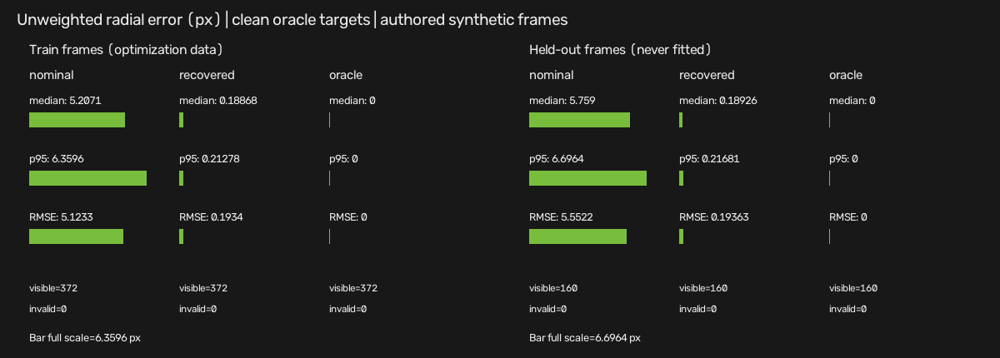

# Synthetic recovery V1 verification

Measured implementation: `da261d1816aefe115d2e9bb733f5bc6ec15791f4`, clean at
Release configuration. The immutable `v0.1.0` tag is unchanged. This is an
additive geometry experiment, not a perception/runtime release.

## Checks

| Check | Result |
| --- | --- |
| Fresh macOS dev tree, final full CTest | 133/133 passed |
| Fresh clean-commit macOS Release tree, full CTest | 133/133 passed |
| Format-check and full 42-TU clang-tidy | Passed; no actionable project diagnostics |
| Frozen Release A-E campaign | 21 cases retained; required gates passed |
| Repeated search on identical inputs | Equal canonical keys/memberships/losses/counts and status in all 21 cases |
| Final visuals | Inspected rich/narrow surfaces, all-invalid surface, residual plot and held-out overlays |
| Native macOS ASan+UBSan | Failed during existing rigid-transform test discovery, before recovery tests; allocator initialization CHECK in `sanitizer_malloc_mac.inc` |
| First Ubuntu run on `da261d1` | GCC and Clang runtime tests passed 133/133; Clang static gate failed on three optional-access diagnostics; sanitizer job still pending |
| Final supported Ubuntu gates | Pending verification of the portable optional guards; no checks disabled |

Fresh local directories were `build/recovery-v1-dev`, `build/recovery-v1-release`
and `build/recovery-v1-asan`; the compiler was AppleClang 16.0.0.16000026.
Release provenance records Apple M4 Pro, arm64, Darwin 25.6.0, and
`git_dirty=false`. The native sanitizer failure is not called a passing run;
the supported Ubuntu sanitizer gate must pass independently.

The full raw run is retained locally under
`artifacts/extrinsic_recovery/verified_da261d1/`. The
[public machine-readable extraction](evidence/extrinsic_recovery_v1.json)
retains all cases, signed/absolute parameter errors, observed/clean metrics,
visibility, conditioning and failure statuses. Array model order is explicitly
`nominal`, `recovered`, `oracle`; null is unavailable, not zero error.

## Measured results and failures

| Experiment | Clean held-out result | Interpretation |
| --- | --- | --- |
| A: seven noiseless signed/axis/joint cases | All pass half-step parameter gates and held-out gates | On-grid authored truth; not universal accuracy |
| B: five fixed antithetic-noise seeds, sigma 1 px | Same truth grid point selected in all five; observed residuals remain nonzero | Correlated zero-mean pairs are favorable on this geometry; not i.i.d. noise robustness |
| C: 37 bad training correspondences (19/192 + 18/180) | L2 RMSE 4.09510 px; Huber RMSE 0.193634 px | Huber improves normalized parameter error 0.112805 → 0.005, but both miss strict clean parameter gate |
| D: rich versus narrow training geometry | Scaled condition 8.71134 versus 380386 | Narrow case happens to recover the on-grid truth but is not accepted as identifiable |
| E: restricted yaw/translation bounds | Both `bound_limited` | Pinned answers are not successful recovery |
| E: nonidentity nominal translation | Strict recovery gate passes | Confirms left-applied composition under the declared offset |
| E: off-grid truth (0.733 deg, 0.0268 m) | Recovered (0.72 deg, 0.03 m); held-out RMSE 0.0788816 px | `refinement_limited`; yaw/translation errors exceed half fine steps despite strong residual improvement |
| E: supplemental all-invalid candidate grid | 1681 rejected candidates; null recovered result | Explicit failure report and crossed-out surface preserved |

All normal default searches used 2113 unique candidates, 372 training points
per candidate and 786036 training point projections. Local SVD diagnostics
and reproducibility replay have separate counters/timing. Raw elapsed times are
one timed search per case, no explicit warm-up, no percentile calculation;
they are diagnostics, not a steady-state latency benchmark. Preparation,
evaluation, rendering and publication are not runtime sojourn.

The deliberately oversized test-only coarse steps (0.5 deg, 0.025 m) also missed
the joint optimum at an artificial refinement edge. That failure is retained as
a regression; reference checks use frozen production steps on reduced bounds
and analytic fixtures for all seven noiseless cases. No production threshold or
search setting was retuned after observing results.



## Reproduction and extraction

See [the experiment commands](extrinsic_recovery.md#implemented-entry-points).
To reproduce this historical source rather than a later HEAD, use a separate
checkout of the exact implementation commit above. Local paths/hardware/timing
may differ; compare numerical decisions within tolerances, not whole report bytes.
Do not replace the historical evidence file just to match a later commit.

The optional public-summary extraction uses `jq` (not an application/runtime
dependency). After a campaign named `campaign`:

```bash
jq -s --slurpfile campaign artifacts/extrinsic_recovery/campaign/campaign.json \
  -f examples/export_extrinsic_evidence.jq \
  artifacts/extrinsic_recovery/campaign/runs/*/report.json \
  > artifacts/extrinsic_recovery/public_summary.json
cp artifacts/extrinsic_recovery/campaign/runs/D_rich/loss_surface.png \
  docs/assets/extrinsic_recovery/rich_loss_surface.png
cp artifacts/extrinsic_recovery/campaign/runs/D_narrow/loss_surface.png \
  docs/assets/extrinsic_recovery/narrow_loss_surface.png
cp artifacts/extrinsic_recovery/campaign/runs/C_huber/residual_comparison.png \
  docs/assets/extrinsic_recovery/huber_residuals.png
```

Only project-authored synthetic output is public. Raw candidate/residual tables,
fixtures, build directories and private rehearsal material remain ignored.
